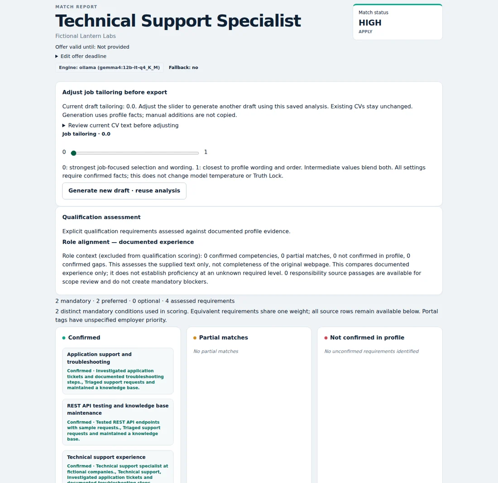
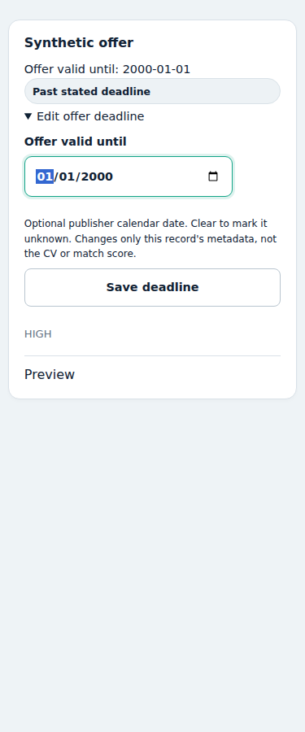
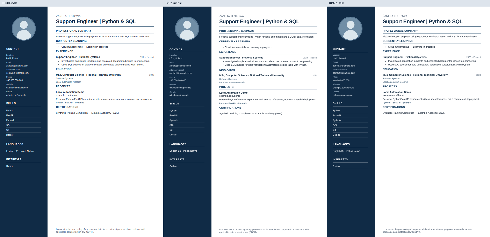
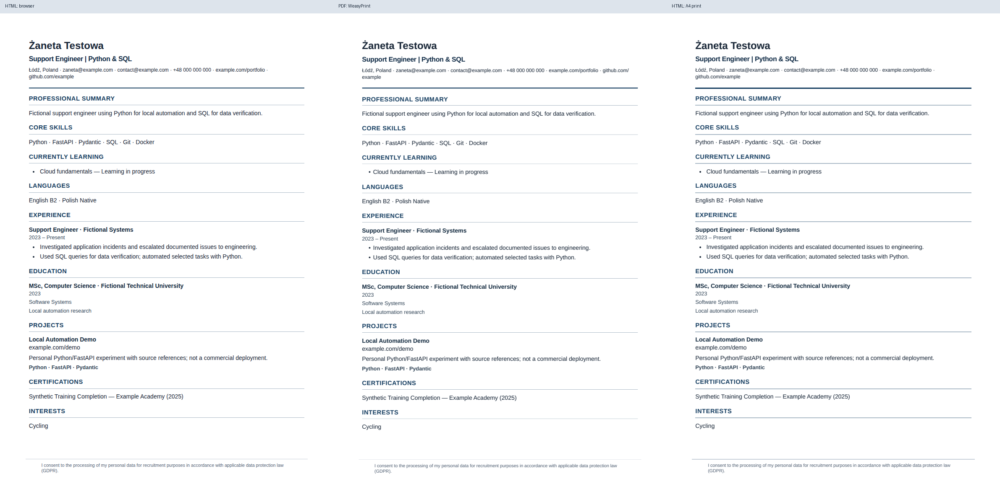
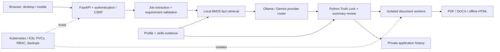

# CVTailor — AI Resumes Without Invented Experience

**Self-hosted AI resume tailoring that matches documented candidate experience to
job requirements, checks unsupported claims, and generates professional CVs.**

[](https://github.com/Rafalbanas/ai-resume-tailoring-platform/actions/workflows/ci.yml)
[](Dockerfile)
[](LICENSE)
[](docs/kubernetes-production.md)
[](docker-compose.yml)
[](#ai-providers)

**[Try locally](docs/quickstart.md) · [Watch the walkthrough](#see-it-working) ·
[Documentation](docs/README.md) · [Contribute](CONTRIBUTING.md)**

## See it working

<a href="docs/media/02-match-report.png"></a>

*Actual application capture with fictional data, using Ollama. Match reports show
documented alignment, not hiring probability or an official ATS score.*

<details>
<summary>Mobile interface and both resume templates</summary>



**Modern Sidebar** — two-column PDF/HTML presentation with optional photo.



**ATS Classic** — single-column, text-focused PDF/HTML presentation.



These template comparisons were generated by the
[synthetic comparison script](scripts/compare_resume_themes.py), separately from
the application recording. They are not evidence of a completed UI export.
DOCX is editable; its layout is not a pixel-identical copy of the PDF.

</details>

**[Watch local Ollama analysis and drafting](docs/media/cvtailor-gemma-generation.webm)**
or read the [text walkthrough](docs/demo-walkthrough.md).
The existing silent WebM recording shows successful analysis and CV drafting,
**not successful end-to-end export**: the in-app document export timed out.
[Capture details and limitations](docs/media/README.md).

## Tailor the presentation, not the experience

Generic AI resume tools can turn a job requirement into a candidate claim.
CVTailor instead starts from your master profile and evidence-linked skills bank.
It selects relevant facts, makes gaps visible, and validates the draft outside the
LLM before document generation. Your profile is your attestation, not an external
background check; human review remains essential.

### Three steps

1. **Add your facts.** Maintain experience, projects and skill levels in one profile.
2. **Analyze an offer.** Paste a description or fetch one selected public job URL;
   inspect requirements, evidence and gaps.
3. **Review and export.** Generate a tailored draft, check warnings and confirm
   the summary when required, then save PDF, DOCX or offline HTML/HTML + CSS ZIP.

### Core features

- **Evidence-backed matching:** separates required qualifications from benefits,
  responsibilities and role fit, with source references and review warnings.
- **Truth Lock:** independent Python validation checks source facts, skills and
  proficiency; new AI drafts use full validation.
- **Local or cloud AI:** use Ollama, Gemini, or deterministic mock mode without an API key.
- **Two resume themes:** Modern Sidebar and ATS Classic, with export/layout checks;
  ATS compatibility varies by recruitment system.
- **An editable workflow:** browser editing, saved versions, comparison and History.
  [Custom CV / AI Editor](docs/custom-cv-editor.md) also works without a job offer.
- **Bounded automation:** a [batch API](docs/batch-api.md) handles explicitly supplied
  URLs; this is not a job crawler or an automatic application sender.

## What Truth Lock does (and does not do)

With full validation, generated claims are checked against source IDs and eligible
skills. Unsupported bullets can be replaced with source wording; unknown skills
are removed. Project work must not become commercial employment, and Basic or
learning-level knowledge must not become expertise.

**Fictional example** ([executable regression](tests/test_fact_validator.py)):

| Input | Result with full Truth Lock |
|---|---|
| Source: “Automated a verified operational workflow with Python.” | The documented employment fact remains available. |
| Draft: “Invented Kubernetes achievement”, citing that Python fact | Unsupported wording is replaced by the actual source sentence. |
| Draft skill: Kubernetes, absent from the profile | Removed, with a warning—not added to the profile. |

This is a deterministic validator example, not a live-model quality benchmark.
Truth Lock is **not a guarantee against all hallucinations**. Semantic summary
review can be wrong; non-source summaries require explicit confirmation before
web export. An owner can deliberately relax validation for a
[manually authored saved CV](docs/safe-manual-cv-edits.md); manual additions do not
become verified facts or alter the master profile.

## AI providers

| Provider | Use | Data boundary |
|---|---|---|
| **Ollama** | Local structured generation and analysis | Use a trusted local endpoint; disable cloud fallback for local-only AI processing. |
| **Gemini** | Direct Google API | Sends job text and candidate analysis facts to Google; requires your API key. |
| **Mock** | Deterministic onboarding and tests | No model calls; not a demonstration of LLM quality. |
| **n8n** | Optional [webhook integration](docs/n8n-setup.md) | Data handling depends on your external workflow. |

Ollama/Gemini routing includes bounded operation budgets and configurable fallback.
The fallback setting matters for privacy; selecting Ollama alone does not prove
that cloud fallback is disabled. See [provider details](REFERENCE.md#ai-providers-and-fallback-behavior).

## Quick Start: try with fictional data

On a **fresh Linux checkout**, with Docker Engine, Compose v2+ and Python 3
(standard library only for initialization):

```bash
git clone https://github.com/Rafalbanas/ai-resume-tailoring-platform.git
cd ai-resume-tailoring-platform
python3 scripts/init_demo.py
docker compose up -d --build
curl --fail http://127.0.0.1:8000/health
```

Open **http://127.0.0.1:8000**, then read `APP_USERNAME` and `APP_PASSWORD` from
your local `.env` privately. Initialization generates independent random secrets,
uses Alex Example's fictional profile, and disables AI fallback. It refuses to
overwrite existing configuration or account state. **This is mock mode**, not a
public demo. Initial image/browser downloads can take longer than five minutes.

Compose is the **alternative local/standalone path**, not a replacement for K3s.
It uses Linux host networking; do not assume these commands work unchanged on
Docker Desktop. Read the [full Quick Start and troubleshooting](docs/quickstart.md)
for platform limits, shutdown, real AI and safe handling of personal data.

## Technology stack

**Python <!-- PYTHON_VERSION:START -->3.14<!-- PYTHON_VERSION:END --> · FastAPI · Pydantic · Jinja2 · Ollama / Gemini ·
WeasyPrint / python-docx · Playwright · Docker · Kubernetes / K3s · GitHub Actions**

Default retrieval is **local lexical BM25**, not semantic vector search.
[Optional hybrid embeddings and LangGraph](docs/hybrid-semantic-matching.md) are
default-off and preserve the validation boundary; no quality uplift is claimed.

<details>
<summary>Dependency sources (generated; exact pins live in requirements files)</summary>

<!-- TECH_STACK:START -->
| Component | Version source | Category | Purpose |
|---|---|---|---|
| **Python** | [Dockerfile](Dockerfile) | Runtime | Container runtime & execution environment |
| **FastAPI** | [requirements.txt](requirements.txt) | Backend | Asynchronous REST API framework & routing |
| **Uvicorn** | [requirements.txt](requirements.txt) | Backend | High-performance ASGI production server |
| **python-multipart** | [requirements.txt](requirements.txt) | Backend | Multipart form data & resume file upload streaming |
| **Pydantic** | [requirements.txt](requirements.txt) | Core | Data validation, settings, and domain schemas |
| **Pydantic Settings** | [requirements.txt](requirements.txt) | Core | Settings management and environment parsing |
| **PyPDFium2** | [requirements.txt](requirements.txt) | Document Engine | PDF geometry, text layout & bounding box inspection |
| **WeasyPrint** | [requirements.txt](requirements.txt) | Document Engine | Visual CSS / Paged Media PDF generation |
| **pypdf** | [requirements.txt](requirements.txt) | Document Engine | PDF manipulation, stream extraction & structural checks |
| **python-docx** | [requirements.txt](requirements.txt) | Document Engine | ATS-friendly Microsoft Word document generation |
| **BeautifulSoup4** | [requirements.txt](requirements.txt) | Job Extraction | Resilient HTML parsing & job posting sanitization |
| **Playwright** | [requirements.txt](requirements.txt) | Job Extraction | Headless Chromium browser automation & SSR fallback |
| **HTTPX** | [requirements.txt](requirements.txt) | Networking | Async HTTP client for MCP, Gemini, and external APIs |
| **Jinja2** | [requirements.txt](requirements.txt) | Templates | Jinja2 HTML resume template rendering engine |
| **Pillow** | [requirements.txt](requirements.txt) | Media | Profile photo validation, scaling, and cropping |
| **pillow-heif** | [requirements.txt](requirements.txt) | Media | HEIF / HEIC photo decoding for mobile camera uploads |
| **Argon2-cffi** | [requirements.txt](requirements.txt) | Security | Argon2id password hashing & credential storage |
| **itsdangerous** | [requirements.txt](requirements.txt) | Security | Cryptographic signing & HMAC summary review attestation |
| **email-validator** | [requirements.txt](requirements.txt) | Validation | RFC-compliant email address validation |
| **pytest** | [requirements-dev.txt](requirements-dev.txt) | Testing | Automated test runner and assertion framework |
| **pytest-asyncio** | [requirements-dev.txt](requirements-dev.txt) | Testing | Asynchronous test execution for pytest |
| **Ruff** | [requirements-dev.txt](requirements-dev.txt) | Tooling | Fast Python linter and code style enforcement |
| **Jsonschema** | [requirements-dev.txt](requirements-dev.txt) | Dependency | Application dependency |
| **Tokenizers** | [requirements.txt](requirements.txt) | Dependency | Application dependency |
<!-- TECH_STACK:END -->

</details>

## Architecture



The [architecture guide](docs/architecture.md), [retrieval design](docs/rag.md)
and [processing boundaries](docs/processing-security.md) describe the implementation.
CI checks contracts, security regressions, document layout and full/split Docker
images. Results depend on the revision and environment; the CI badge is the live
status, not a claim that every deployment is verified.

## Deployment

- **Kubernetes / K3s:** the existing production architecture includes persistent
  account storage, separate processing services, RBAC, reverse-proxy/TLS integration,
  backups, monitoring and digest-pinned delivery with rollback. Start with the
  [K3s production guide](docs/kubernetes-production.md); use the separate
  [Kubernetes lab](docs/kubernetes-lab.md) for practice.
- **Docker Compose:** alternative standalone Linux installation using API,
  document and browser images; only the API mounts account data.
  [Deployment guide](docs/deployment.md) · [runtime images](docs/runtime-images.md).
- **Local Python:** contributor environment and checks in [CONTRIBUTING.md](CONTRIBUTING.md).

**Maintainers:** pushes/merges to `main` trigger the configured production CD
workflow. Opening a PR does not deploy; review deployment impact before merging.

## Security, privacy and limitations

- Built for **owner-managed self-hosting**, not anonymous multi-tenant SaaS.
  The optional separate demo account is an application boundary, not an OS sandbox.
- Argon2id authentication, revocable sessions, CSRF checks, URL/SSRF defenses and
  resource budgets reduce risk; they are not a security guarantee.
- Local inference is not encryption at rest. Profiles, generated documents and
  backups contain personal data. Control access, retention and backup storage.
- Fetching public offers contacts their sites. Gemini, cloud fallback and external
  n8n workflows have their own data boundaries.
- Extraction can fail on protected job sites; paste the description instead.
  Review every claim and rendered document. Match assessments are not hiring odds.
- PDF/HTML and DOCX layout differ; offline A4 HTML can scroll horizontally on mobile.
  See [accessibility status](ACCESSIBILITY.md) and [export limitations](docs/offline-html-export.md).

Read [SECURITY.md](SECURITY.md) and report vulnerabilities privately, not in public issues.

## Documentation and contributing

[Documentation index](docs/README.md) · [Detailed feature/configuration reference](REFERENCE.md) ·
[Evidence matching](docs/evidence-matching.md) · [CV quality guards](docs/cv-quality-guards.md)

Small documentation fixes, reproducible bugs and accessibility feedback are welcome.
Read [CONTRIBUTING.md](CONTRIBUTING.md), follow the [code of conduct](CODE_OF_CONDUCT.md),
and use the [issue forms](https://github.com/Rafalbanas/ai-resume-tailoring-platform/issues/new/choose).
Use fictional profiles in examples and screenshots. This is a personal project;
support and review are best-effort.

## License

Open source under [Apache-2.0](LICENSE). See [NOTICE](NOTICE) for attribution.
