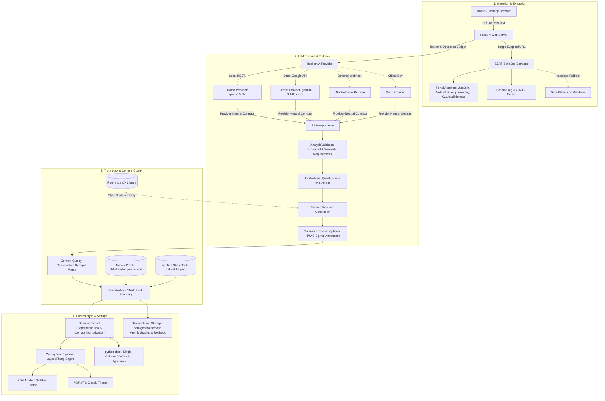

# CVTailor — AI Resume Tailoring Automation Platform

A private, mobile-first web application that analyzes specific job postings, evaluates candidate match against a verified master profile, enforces strict fact validation (Truth Lock), and generates ATS-friendly PDF and editable DOCX resumes.

CVTailor is designed as a production-grade, single-owner automation system demonstrating Python backend development, secure web extraction, structured LLM integration with resilient fallback, cryptographic attestation, and deterministic document generation.

See the [documentation index](docs/README.md) for setup, operations, feature guides and historical reports.

> [!IMPORTANT]
> **Essential Operating Principles & Disclaimers:**
> - **Single-posting analysis only**: CVTailor fetches and analyzes only explicitly provided job postings (one URL or pasted text at a time). It does **not** crawl or scrape job portals en masse.
> - **Documented evidence assessment, not hiring probability**: Match scores (`HIGH` / `MEDIUM` / `LOW` / `UNRELIABLE`) and recommendations (`APPLY` / `REASONABLE STRETCH` / `SKIP` / `RETRY` / `REVIEW`) evaluate alignment between job requirements and documented facts in the candidate profile. They do **not** represent probability of employment or an official ATS ranking.
> - **Separation of qualification match from role alignment**: Qualification scoring assesses documented competencies against required skills, while role recommendations incorporate seniority fit, domain context, and requirement completeness.
> - **Fact validation bounds claims, not guarantees zero errors**: With Truth Lock enabled, the Python-side validator eliminates ungrounded statements and unverified skills by mapping claims back to verified profile facts. A document-specific manual editing switch is available for owner-authored CVs. However, human review of the analysis, profile facts, and rendered exports is always required before submitting an application.
> - **Third-party data transmission with Gemini**: While local Ollama inference keeps data strictly on your machine, configuring or falling back to Google Gemini transmits job and candidate analysis data to Google's Generative Language API.
> - **Security posture**: The platform is built for private, single-owner self-hosting. It implements Argon2id authentication, SQLite server-revocable sessions, CSRF tokens, SSRF guards, and rate limiting. It does **not** claim data encryption at rest, immunity to prompt injection, universal ATS compatibility, or public multi-tenant SaaS readiness.

---

## Per-CV Truth Lock switch

Open a saved CV in **Edit CV** or its preview and set **Validation level** to **0** and apply. The page shows **OFF — manual CV**. **1** enables full source validation; any intermediate value (for example **0.5**) allows manual Skills while other sections stay source-validated. All intermediate values share that permission; they are not a probability of truth. You can then save your own headline, summary, skill names and existing experience/project text without profile-source validation. For example, manually entered `Azure AD` is retained exactly, without adding a proficiency label. The setting belongs to that document; new AI generation and other CVs keep Truth Lock on by default.

Manual edits are not marked as verified: changed skill IDs are cleared, changed summaries lose their source citations/attestation, and changed bullets/projects receive explicit `manual:` references. Authentication, CSRF, typed fields, summary confirmation, export quality checks and staged PDF/DOCX rollback remain active. Turning validation back on audits the saved content and refuses unsupported claims instead of relabelling them as verified. Restore the generated version or regenerate from updated profile evidence if needed. No profile, Skills Bank or existing CV is changed simply by adding this feature. See [manual editing details](docs/safe-manual-cv-edits.md).

## Job tailoring control

Set **Job tailoring** before submitting the job offer (default **0** retains relevance-first retrieval): **0** prioritizes relevant facts and job-focused wording, **1** favors profile order and source wording, and intermediate values blend these goals (step 0.1). This is independent of the per-CV Truth Lock setting. New AI drafts always use full Truth Lock. The value travels with the job, retries, idempotency key and saved application. On the match report, adjust it and choose **Generate new draft · reuse analysis** before exporting. Only submit when ready; moving the slider makes no request. From an existing CV, **Create a new version with different job tailoring** reuses the saved offer analysis and generates a new draft from current profile facts without changing that CV or copying manual additions.

The value continuously blends normalized BM25 scores with canonical profile order among matching facts, and supplies a numeric rewriting budget to Ollama/Gemini. Fact provenance, competence levels and source validation remain mandatory. This is not model temperature, a truth percentage, or a guarantee that every slider step produces visibly different text. The mock provider does not paraphrase; external n8n integrations must explicitly honor this field. Retrieval diagnostics retain the level and ranking scores.

Ranking is local and consumes no model tokens. The small policy object adds input tokens but no extra LLM request. Subsequent slider-driven drafts reuse the saved analysis and call only CV generation with Ollama/Gemini, within the existing provider timeout/fallback policy. Analysis is revalidated locally against the current profile before reuse; unreliable reports require fresh analysis. This avoids repeating the analysis LLM stage; it does not guarantee a specific latency or token reduction. N8n providers without a separate tailoring stage cannot use this shortcut; the existing 24-match/16,000-character context budget remains unchanged (identity anchors and the documented fallback are exceptions). Token usage depends on selected text, provider/tokenizer and generated output, not monotonically on this slider. Existing usage reporting records actual provider usage; no savings are claimed.

## Candidate fact RAG

CV generation through **Ollama and Gemini** now retrieves relevant candidate facts before calling the LLM. Earlier versions supplied the entire profile to generation; evidence matching for analysis and reference-CV style selection already existed. [The audit and implementation guide](docs/rag.md) identifies the files and functions behind this distinction.

- **Sources and chunks:** `FactCatalog` turns the current master profile into individual facts with stable source IDs, type and owner. Employment, projects and education remain separate; skills are filtered by the existing verified skills bank. Profile facts remain candidate attestations.
- **Retrieval and ranking:** a local Python **BM25** index searches fact text using analyzed job requirements and role competencies. Mandatory requirements have weight 2, others 1, and the role 0.5. Scores are normalized per query length and summed. Defaults: 24 ranked candidates and 16,000 source-text characters, plus identity anchors for summary, employment chronology and education. Whole facts are selected, never truncated. These are code constants in `app/services/fact_retrieval.py`, not new environment settings.
- **Generation context:** selected facts/IDs, employment identities and project links are passed to the generator. Ollama's schema uses the selected source IDs. Analysis still sees all evidence to avoid treating retrieval misses as missing qualifications. Mock and legacy n8n webhook generation keep their existing behavior.
- **Updates and isolation:** each request rebuilds an in-memory index from its own current profile. There is no persistent retrieval index or shared cache, so profile changes cannot leave stale cached facts and retrieval cannot search another candidate's corpus.
- **No matches and fallback:** no hits keeps identity anchors; an index/search failure uses that candidate's canonical catalog. Both paths retain the same Truth Lock, skill eligibility and export review checks. Fallback can require more model context.
- **Traceability:** new drafts and new application metadata record selected IDs, types, owners, scores, selection reasons, query weights and index revision. Direct providers also save a source-text snapshot after generation for provenance across profile edits. Final resume JSON retains source citations. Existing exports and application history are not rewritten.

For example, with the same synthetic profile, a Technical Support Engineer query about customer tickets/network incidents ranks an employment incident-investigation fact first; an AI/Python Developer query about Python/FastAPI/JSON ranks a personal project fact first. Adding Kubernetes to the offer creates no candidate Kubernetes evidence. Retrieval selects context; **Truth Lock independently checks what may appear in the CV**, including actual skill levels and the distinction between project work and commercial employment. Job descriptions and retrieved documents are untrusted data, never model instructions.

The retrieval layer uses only the Python standard library, with no additional service, dependency or paid retrieval API. It uses **no embeddings or vector database**. Memory grows with profile tokens; queries scan the candidate's fact documents. Lexical matching has limited synonym and multilingual recall, and the source-character budget is not a total prompt/token limit. No quality or performance improvement percentage has been measured. See [RAG details and limitations](docs/rag.md), [verification results](docs/archive/rag-verification.md) and the [canonical project description and CV wording](docs/project-description.md).

## Architecture



### Pipeline Breakdown

1. **SSRF-Safe Web Extraction**: Fetches a single user-supplied job URL. Validates and pins IP addresses, prevents DNS rebinding, blocks internal/loopback/private IP ranges (RFC 1918, RFC 3927), limits redirects, and parses portal-specific HTML structures (JustJoin.it, NoFluffJobs.com, Pracuj.pl, MyWorkdayJobs, CzyJestEldorado via official JSON-RPC MCP), JSON-LD Schema.org data, or falls back to headless Playwright rendering.
2. **LLM-First Requirement Interpretation (`JobInterpretation`)**: A shared, provider-neutral Pydantic contract between Ollama and Gemini. Extracts requirements with literal source quotes, priorities (`mandatory`, `preferred`, `optional`, `context`), provenance source IDs, explicit `AND` / `OR` logical components, and uncertainty flags.
3. **Requirement Grounding & Semantic Validation (`AnalysisValidator`)**: Separates qualifications from employment benefits and marketing context. Distinguishes negated statements (e.g. "no commercial experience with X" vs. expertise) and flags ambiguous postings as `REVIEW` or `UNRELIABLE / RETRY`.
4. **Offer-Specific Resume Tailoring**: The active model ranks candidate evidence and selects relevant factual source statements and verified skills for the specific offer, without ever fabricating claims or promoting skill levels.
5. **Natural Summary Review & Signed HMAC Attestation (`summary_review.py`)**: When an LLM generates a fluent summary paragraph, it is independently validated against candidate facts and identity. Approved summaries receive a server-side HMAC signature binding text, citations, and profile facts. Incomplete citations, manual edits, or unverifiable claims fall back to exact attested profile sentences.
6. **Conservative Content Deduplication (`content_quality.py`)**: Merges overlapping project and experience statements (e.g. repetitive VPS or ML pipeline statements) by tracking concept sequences and actions while strictly preserving distinct tools, numbers, and scopes (local vs. production).
7. **Truth Lock (`FactValidator`)**: Python boundary mapping model output back to the candidate's verified profile catalog (`data/master_profile.json`) and skills bank (`data/skills.json`). Replaces unevidenced paraphrases with verbatim profile facts, excludes unverified skills, and guarantees the candidate's actual occupation is preserved (rejecting unheld target titles).
8. **Document Generation**:
   - **PDF Engine**: Renders pixel-accurate A4 documents using Jinja2 and WeasyPrint in Modern Sidebar or ATS Classic layouts. Employs dynamic layout fitting to eliminate sparse continuations and orphaned sections, placing a single GDPR consent clause on the final page margin.
   - **DOCX Generator**: Generates cleanly formatted Word documents via `python-docx` with verified native hyperlinks, standard headings, and a single consent footer.
9. **Transactional Storage**: Saves job descriptions, structured analyses, resume JSON, metadata, and export artifacts under `data/generated/`. Manages atomic file staging, versioned backups in `versions/`, and rollback on write errors.

For an extended breakdown of pipeline stages and architectural decisions, see [Architecture Documentation](docs/architecture.md).

---

## Key Features

### 1. Grounded Requirement Analysis & Provenance
- **LLM-First Interpretation**: Breaks job postings into mandatory requirements, preferred qualifications, responsibilities, and organizational context using the provider-neutral `JobInterpretation` schema.
- **Strict Provenance & Quotes**: Each requirement retains its literal quote from the advertisement, priority basis, and explicit logical operators (`single`, `all`, `any`, `ambiguous`).
- **Negation & Scope Handling**: Preserves negative assertions and theoretical constraints. A candidate's documented "no commercial experience in Kubernetes" is kept strictly distinct from operational competency.
- **Section & Benefit Separation**: Recruitment benefits, salary ranges, and company marketing are separated from required candidate qualifications.
- **Ambiguity & Reliability**: Unreliable postings, truncated descriptions, or conflicting multi-role postings are flagged for human `REVIEW` or marked `UNRELIABLE / RETRY`.

### 2. Verified Skills Bank (`data/skills.json`)
- **Evidence-Backed Skills**: CV skills are selected strictly from `data/skills.json`. A skill must be marked `verified`, `enabled`, `allowed_in_cv`, have a non-learning level, and be supported by concrete employment or project evidence (or explicitly confirmed `manual_verified`).
- **Generated CV Skill Coverage**: New CVs target 10–12 distinct confirmed skills (up to 16 when relevant). Direct offer matches rank first; sparse lists are filled from the strongest remaining eligible skills. Fewer are kept when the bank lacks enough eligible, distinct skills. Manual edits keep the selected list.
- **Management UI**: Full in-browser skill management at `/skills` allows editing aliases, priority, category, and evidence links.
- **Health Monitoring**: The `/health/skills` endpoint exposes skill bank validity, verified counts, and learning counts without disclosing personal information.

### 3. Truth Lock & Content Quality Boundary
- **Candidate Title Integrity**: The headline on generated resumes reflects the candidate's actual documented occupation (e.g., Technical Support Engineer / IT Specialist), rejecting unheld target titles like "Senior Cloud Architect".
- **Anti-Elevation Guards**: Basic skills remain basic; documented English B2 is never elevated to C1 or native/fluent; local scripts are never presented as production CI/CD pipelines.
- **Natural Summary with HMAC Attestation**: Fluent professional summaries are reviewed against supplied facts. Approved summaries carry a cryptographic server HMAC (`summary_attestation`). If the review is rejected, times out, or is modified, the summary automatically falls back to verified source sentences.
- **Conservative Presentation Deduplication**: Cleans repetitive phrasing across projects and experience bullets while preserving distinct qualifiers, numbers, and tooling.

### 4. Dual Resume Themes & Layout Integrity
- **Modern Sidebar Theme**: Two-column layout featuring a navy blue sidebar with contact details, core skills, languages, an optional profile photo or initials, and a seamless GDPR clause without borders or steps. The main section displays professional summary, experience bullets, projects, education, and certifications.
- **One-Page Policy for Modern Sidebar**: Newly generated Modern Sidebar resumes strictly target a crisp single-page PDF. The engine consolidates redundant bullets, uses concise cited summary/project facts, and omits lower-priority optional details if needed. Employment history, education, verified competence levels, and mandatory evidence remain protected. If protected content cannot physically fit on one page, generation returns a clear HTTP 422 recommending ATS Classic or manual editing.
- **ATS Classic Theme**: Single-column, minimalist, text-focused layout without photos or multi-column grids, maximizing automated ATS readability and natural multi-page flow.
- **Currently Learning Section**: Dedicated, separate section across PDF/DOCX layouts displaying job-relevant `learning` skills with explicit `manual_verified` declarations. Courses render as "Course in progress" while general self-study renders as "Learning in progress". They are never promoted into Core Skills or satisfied qualifications.
- **Dynamic Layout Fitting**: WeasyPrint page boxes and text bounds are dynamically evaluated. Spacing and skill counts adapt to prevent sparse continuations (e.g. a single dangling bullet on page 2) while keeping all factual content intact.
- **Single GDPR Consent**: The recruitment consent clause is placed cleanly at the bottom margin of the final page in both PDF and DOCX.

### 5. Multi-Portal Job Extraction & Resilient Copied-Page Cleaning
- **CzyJestEldorado (`czyjesteldorado.pl`)**: Connects to the official remote Model Context Protocol (MCP) server at `https://czyjesteldorado.pl/_mcp` via JSON-RPC, bypassing Cloudflare Turnstile blocks. Automatically retrieves role titles, company names, salary ranges, employment conditions, and technology tags. When pasting full offer descriptions copied from the browser, the extractor cleanly isolates detailed requirements (including tools like Docker and Kubernetes), responsibilities, and conditions while stripping portal UI noise.
- **Pracuj.pl**: Dedicated extraction pipeline isolating descriptions, responsibilities, requirements, and tech tags while discarding recruitment widgets, cookies, and navigation elements. If anti-bot defenses return HTTP 403, users can paste the copied page into the description field and run **Clean pasted job offer** to parse employer, title, and structured content locally.
- **The Protocol (`theprotocol.it`)**: Extracts employer, title, requirements, preferences, responsibilities, project context and employment conditions from offer HTML or full pages copied from the browser. Required technology tags remain mandatory, while optional technologies remain preferences. Company advertising, benefits, repeated offer summaries and application forms are discarded. Copied pages are recognized without a URL when both technology section headings are present. If URL fetching returns an unsupported-browser page, paste the offer into the description field and use **Clean pasted job offer**; cleaning works without network access.
- **JustJoin.it & NoFluffJobs**: Custom HTML and JSON-LD Schema.org adapters capturing salary ranges, contract types, seniority levels, and tech stacks.
- **Workday & Enterprise ATS**: JSON-LD Schema.org and Workday-specific layout extractors with Playwright headless fallback.
- **Universal Copied Offer Cleaning**: The **Clean pasted job offer** button works with any job board or corporate career site without network overhead, detecting Polish and English section headers, removing boilerplate controls, and extracting role/company metadata.

### 6. Document Export & Hyperlink Integrity
- **PDF Export**: Pixel-accurate WeasyPrint rendering with native hyperlink annotations (`mailto:`, `https://`) and Poppler-verified geometry.
- **DOCX Export**: Clean, single-column editable Word document with active hyperlinks and standard headings for universal compatibility.
- **URL & Contact Normalization**: RFC-compliant URL parsing and normalization preserve ASCII URLs byte-for-byte, encode Unicode paths cleanly, and format readable display text while keeping tracking parameters in link targets.

### 7. In-Browser Resume Editing
- **Interactive Form**: Edit professional summary, selected skills, experience bullets, and projects directly in the browser.
- **Instant Truth Lock Re-validation**: Manual edits are checked against the candidate's verified profile catalog. Unsupported claims return HTTP 422 with actionable error messages and preserve form state without corrupting the saved resume.

### 8. Security & Privacy
- **SSRF Defense**: IP address validation, IP pinning, DNS rebinding mitigation, RFC 1918/3927 blocking, and strict redirect limits.
- **Authentication**: Argon2id password hashing in `data/auth.json` (file mode `0600`), SQLite-backed login rate limiting shared by workers (5 attempts per 5 minutes per IP, 100 per instance), and server-revocable SQLite sessions (`data/sessions.sqlite3`). Multiple devices can sign in concurrently; **Sign out everywhere** revokes all sessions of that account. Sessions have an absolute eight-hour lifetime by default (`SESSION_TTL_SECONDS=28800`).
- **CSRF & Cookie Protection**: Browser-session-bound double-submit CSRF token validation and signed cookies (`HttpOnly`, `SameSite=Strict`, `Secure` under HTTPS).
- **Shared login**: Private and demo credentials can use the same `/login`, with server-side session checks routing every request to its isolated runtime and data directory. [Setup and migration](docs/recording-demo.md).
- **History retention**: Automatic cleanup of analysis tasks and unsaved drafts is disabled by default (`AUTO_DELETE_HISTORY=false`). Set it to `true` to keep the latest 100 task records; saved CV history is never automatically deleted. Storage limits reject new work rather than deleting old CVs.
- **Processing isolation & budgets**: PDF/DOCX/photo work runs in bounded child processes outside the event loop. Production isolation requires deploying the separate owner/demo workers without account mounts or AI keys; shared concurrency, persistent AI budgets, task/storage quotas and early body limits protect resources. [Limits, live inspection and migration](docs/processing-security.md).
- **Summary export review**: Model-approved natural summaries require explicit user confirmation of the displayed text and profile sources before export. Confirmation is bound to the exact summary, facts, account and document; changes invalidate it. Deterministic source-composed summaries need no extra confirmation. [Audit evidence and limitations](docs/security-audit-2026-10-17-followup.md).
- **Diagnostics & History**: `/diagnostics` dashboard for health metrics, active model status, and build metadata; `/compare` view for side-by-side CV comparison; atomic file staging and version backups under `data/generated/`.

---

## AI Providers and Fallback Behavior

CVTailor decouples the application from the underlying LLM via `AIProvider`:

| Provider | Identifier | Connection Type | Target Use |
|---|---|---|---|
| **Ollama** | `ollama` | Local REST (`POST /api/chat`) | Default private local inference (`qwen3.5:9b`) |
| **Google Gemini** | `gemini` | Direct Google API (`generativelanguage.googleapis.com`) | Cloud inference via Google AI Studio API key (`gemini-3.1-flash-lite`) |
| **Auto** | `auto` | Managed Router (`ResilientAIProvider`) | Primary provider with automatic fallback |
| **Mock** | `mock` | Local Python generator | Deterministic offline development and automated testing |
| **n8n** | `n8n` | Webhook with `X-Webhook-Secret` | Delegated n8n workflow execution ([setup guide](docs/n8n-setup.md)) |

### Fallback Routing Rules

The active router evaluates provider preferences as follows:
- **`auto`**: Uses Ollama as primary, falling back to Gemini if Ollama fails or times out.
- **`ollama`**: Uses Ollama as primary, falling back to Gemini if fallback is enabled.
- **`gemini`**: Uses Gemini as primary, falling back to Ollama if fallback is enabled.
- **Fallback Toggle**: Controlled in the authenticated UI (`/settings/fallback`) and persisted in `data/ai_settings.json` (`{"automatic_fallback": true/false}`). When disabled, only the requested primary provider is called.
- **Operation Budget (`LLM_OPERATION_BUDGET_SECONDS`)**: Protects the overall pipeline (default 900.0s). If the primary provider fails and the remaining budget is less than 5 seconds, fallback is aborted to prevent hung tasks.
- **Summary Review Timeout (`SUMMARY_REVIEW_TIMEOUT_SECONDS`)**: The optional HMAC summary review stage has a dedicated 30-second timeout; if it expires or fails, the system smoothly falls back to verified source sentences without failing the generation task.
- **Data Privacy Note**: Enabling Gemini (as primary or fallback) transmits job text and candidate master profile facts needed for analysis to Google's API endpoint.

---

## Technology Stack & Pinned Versions

The platform's runtime environment and dependency versions are strictly pinned and automatically tracked:

<!-- TECH_STACK:START -->
| Component | Pinned Version | Category | Purpose |
|---|---|---|---|
| **Python** | `3.14` | Runtime | Container runtime & execution environment |
| **FastAPI** | `0.143.2` | Backend | Asynchronous REST API framework & routing |
| **Uvicorn** | `0.54.0` | Backend | High-performance ASGI production server |
| **python-multipart** | `0.0.32` | Backend | Multipart form data & resume file upload streaming |
| **Pydantic** | `2.14.1` | Core | Data validation, settings, and domain schemas |
| **Pydantic Settings** | `2.16.0` | Core | Settings management and environment parsing |
| **PyPDFium2** | `5.14.0` | Document Engine | PDF geometry, text layout & bounding box inspection |
| **WeasyPrint** | `70.0` | Document Engine | Visual CSS / Paged Media PDF generation |
| **pypdf** | `6.20.1` | Document Engine | PDF manipulation, stream extraction & structural checks |
| **python-docx** | `1.2.0` | Document Engine | ATS-friendly Microsoft Word document generation |
| **BeautifulSoup4** | `4.15.0` | Job Extraction | Resilient HTML parsing & job posting sanitization |
| **Playwright** | `1.64.0` | Job Extraction | Headless Chromium browser automation & SSR fallback |
| **HTTPX** | `0.28.1` | Networking | Async HTTP client for MCP, Gemini, and external APIs |
| **Jinja2** | `3.1.6` | Templates | Jinja2 HTML resume template rendering engine |
| **Pillow** | `12.3.0` | Media | Profile photo validation, scaling, and cropping |
| **pillow-heif** | `1.8.1` | Media | HEIF / HEIC photo decoding for mobile camera uploads |
| **Argon2-cffi** | `25.1.0` | Security | Argon2id password hashing & credential storage |
| **itsdangerous** | `2.2.0` | Security | Cryptographic signing & HMAC summary review attestation |
| **email-validator** | `2.3.0` | Validation | RFC-compliant email address validation |
| **pytest** | `9.1.1` | Testing | Automated test runner and assertion framework |
| **pytest-asyncio** | `1.4.0` | Testing | Asynchronous test execution for pytest |
| **Ruff** | `0.17.1` | Tooling | Fast Python linter and code style enforcement |
<!-- TECH_STACK:END -->

---

## Repository Structure

```
ai-resume-tailoring-platform/
├── app/
│   ├── cli.py                     # CLI management commands (e.g. reset-password)
│   ├── main.py                    # FastAPI application initialization & middleware
│   ├── core/                      # Core configuration, logging, and security guards
│   │   ├── config.py              # Pydantic Settings & environment variables
│   │   ├── logging.py             # Structured logging setup
│   │   └── security.py            # Argon2id, SQLite sessions, CSRF, and rate limiting
│   ├── models/                    # Pydantic domain models
│   │   ├── candidate.py           # Candidate profile, experience, projects, education
│   │   ├── interpretation.py      # LLM-first provider-neutral JobInterpretation schema
│   │   ├── job.py                 # JobRequest, JobAnalysis, and requirement models
│   │   ├── resume.py              # TailoredResume and CV bullet structures
│   │   └── skills.py              # VerifiedSkill and SkillEvidence schemas
│   ├── routes/
│   │   └── web.py                 # FastAPI web endpoints (analysis, resume, skills, auth)
│   └── services/                  # Business logic and external integrations
│       ├── ai_provider.py         # AI provider base classes and contracts
│       ├── analysis_validator.py  # Validation of LLM requirement interpretations
│       ├── artifact_transaction.py# Atomic file staging, versioning, and rollback
│       ├── auth_store.py          # Argon2id password file management
│       ├── content_quality.py     # Conservative deduplication & quality verification
│       ├── docx_generator.py      # python-docx ATS-friendly document generation
│       ├── evidence_matching.py   # Candidate profile evidence matcher
│       ├── fact_catalog.py        # Tokenizer and source fact catalog
│       ├── fact_validator.py      # Truth Lock boundary and candidate fact enforcement
│       ├── gemini_provider.py     # Google Gemini API provider
│       ├── job_extractors/        # SSRF-safe fetcher & portal parsers (JustJoin, NoFluff, Pracuj, Eldorado via MCP, etc.)
│       ├── job_sections.py        # Section classification (qualifications, duties, benefits)
│       ├── languages.py           # Language proficiency verification
│       ├── mock_provider.py       # Deterministic mock provider for tests & offline dev
│       ├── n8n_provider.py        # n8n webhook provider
│       ├── ollama_provider.py     # Local Ollama REST provider
│       ├── pdf_generator.py       # WeasyPrint PDF renderer with layout fitting
│       ├── professional_summary.py# Source-backed summary construction
│       ├── profile_photo.py       # Profile headshot validation and cropping
│       ├── reference_cvs.py       # Reference CV ingestion for style-only guidance
│       ├── resilient_provider.py  # Provider routing, fallback, and operation budget
│       ├── resume_editor.py       # In-browser CV editing and re-validation
│       ├── resume_export.py       # Contact normalization, link verification, and layout checks
│       ├── semantic_requirements.py# Semantic requirement extraction and grouping
│       ├── session_store.py       # SQLite session storage
│       ├── skills_bank.py         # Verified skills bank loading and filtering
│       ├── storage.py             # Transactional application history storage
│       ├── summary_review.py      # Natural summary review with signed HMAC attestation
│       └── task_manager.py        # Background task queue and progress tracking
├── data/                          # Data directory (profiles, skills, auth, generated CVs)
├── docs/                          # Comprehensive technical and operational documentation
├── scripts/
│   ├── bootstrap_skills.py        # Script to bootstrap skills.json from master profile
│   ├── recording_demo.py          # Isolated runner for synthetic video demo recordings
│   └── sync_readme.py             # Automatic synchronization of README versions & test counts
├── static/                        # CSS stylesheets, JavaScript helpers, and favicon
├── templates/                     # Jinja2 HTML templates for mobile-first web interface
└── tests/                         # Comprehensive automated test suite (767 tests)
```

---

## Installation & Deployment

### Option A: Production K3s Deployment (Kubernetes on VPS)

The production environment operates as a hardened, single-node **K3s (v1.36.5+k3s1)** deployment under the `cvtailor-prod` namespace:
- **Loopback & Ingress Architecture**: Pods listen on host loopback (`127.0.0.1:18000` for main, `127.0.0.1:18001` for demo) via `hostNetwork`, preserving host-level Nginx reverse proxying, TLS termination, and existing SSH tunnels to Ollama (`127.0.0.1:11434`).
- **Storage & Volume Management**: State (master profile, SQLite sessions, tasks, generated CVs) is mounted on dedicated PersistentVolumeClaims backed by host storage under `/storage/cvtailor-k3s-runtime/`.
- **Nightly Backups & Monitoring**: Automated systemd timers execute atomic archives of application volumes with SHA-256 integrity verification.
- **Continuous Deployment**: Starts automatically on pushes to `main`, including merged PRs; manual runs via GitHub Actions `workflow_dispatch` remain available on `main`. Executes automated regression testing, builds and pushes an immutable image by exact digest to GHCR, and deploys via a restricted SSH entrypoint on the VPS with active task draining and automatic rollback.

For complete K3s operations, RBAC, and storage architecture, see [Kubernetes Production Guide](docs/kubernetes-production.md) and [Deployment Guide](docs/deployment.md).

### Option B: Docker Compose Deployment (Standalone VPS)

Docker Compose uses `network_mode: host` on Linux so that the container can reach an Ollama instance running on host loopback (`127.0.0.1:11434`), while Uvicorn binds to `127.0.0.1:${CV_TAILOR_PORT:-8000}` behind your reverse proxy (see [VPS Deployment Guide](docs/deployment.md) for full reverse-proxy and TLS configuration).

1. **Clone the repository**:
   ```bash
   git clone https://github.com/Rafalbanas/ai-resume-tailoring-platform.git
   cd ai-resume-tailoring-platform
   ```

2. **Configure environment variables**:
   ```bash
   cp .env.example .env
   # Configure APP_PASSWORD, CSRF_SECRET, PROCESSING_TOKEN and BROWSER_PROCESSING_TOKEN
   ```

3. **Initialize candidate profile and skills bank**:
   ```bash
   cp data/master_profile.example.json data/master_profile.json
   cp data/skills.example.json data/skills.json
   # Replace example data with your verified candidate facts
   ```

4. **Build and launch the container**:
   ```bash
   docker compose up -d --build
   curl http://127.0.0.1:8000/health
   ```

5. **Initial login and credential migration**:
   Open `http://localhost:8000` (or your reverse-proxied HTTPS URL) and log in using `APP_USERNAME` and `APP_PASSWORD`. On first start, the plaintext password is automatically hashed to Argon2id in `data/auth.json`. You can then remove `APP_PASSWORD` from `.env`.

6. **Resetting passwords**:
   To change the password without using the UI:
   ```bash
   docker compose exec cv-tailor python -m app.cli reset-password
   ```

### Role-specific container images

Compose builds separate **API**, **document worker**, and **browser worker** targets from an explicit Debian Slim base. The API excludes native document/browser packages; workers retain independent account credentials and sandboxing. Set `PROCESSING_TOKEN` and `BROWSER_PROCESSING_TOKEN` before starting Compose, and independent demo equivalents when enabling its profile. Versions still come from the single `requirements.txt` pin file. See [runtime images, checks and size measurements](docs/runtime-images.md).

The default `docker build .` target remains `full` for existing CD/Kubernetes compatibility. The role-image change does not deploy or migrate production automatically.

### Option C: Local Development (Python <!-- PYTHON_VERSION:START -->3.14<!-- PYTHON_VERSION:END -->)

1. **Set up virtual environment**:
   ```bash
   python<!-- PYTHON_VERSION:START -->3.14<!-- PYTHON_VERSION:END --> -m venv .venv
   source .venv/bin/activate
   pip install -r requirements-dev.txt
   python -m playwright install --with-deps chromium
   python scripts/check_environment.py --dev
   python -m pip check
   ```

   The checker rejects a Python version or installed package version that differs from the Docker image and pinned requirements. Recreate an old virtual environment with Python 3.14 before treating its failures as application defects. The same check runs in CI and the built image. Linux native libraries (including `libseccomp2` and `libharfbuzz-subset0`) are required; use the Docker image when the host cannot match this runtime.

2. **Configure local environment**:
   ```bash
   cp .env.example .env
   cp data/master_profile.example.json data/master_profile.json
   cp data/skills.example.json data/skills.json
   ```

3. **Run in offline mock mode**:
   Set `AI_PROVIDER=mock` in `.env` and start the server:
   ```bash
   uvicorn app.main:app --reload --port 8000
   ```

4. **Run with local Ollama**:
   Ensure Ollama is running (`curl http://127.0.0.1:11434/api/tags`), pull the model (`ollama pull qwen3.5:9b`), set `AI_PROVIDER=ollama` in `.env`, and start Uvicorn.

---

## Configuration Reference (`.env`)

All configurable environment variables correspond to `.env.example`:

| Variable | Default Value | Description |
|---|---|---|
| `APP_USERNAME` | — | Initial username for first-run credential bootstrap |
| `APP_PASSWORD` | — | Initial password for first-run bootstrap (migrated to Argon2id hash in `data/auth.json`) |
| `CSRF_SECRET` | — | Required non-default secret for browser-bound CSRF tokens, instance-scoped sessions and summary attestations |
| `BASE_URL` | `https://cv.example.com` | Public base URL; enables `Secure` flag on cookies when using HTTPS |
| `DEMO_DATA_DIR` | unset | Optional separate demo account directory served at the same `/login` |
| `DEMO_CSRF_SECRET_FILE` | demo `csrf.secret` | Independent demo signing secret file |
| `DATA_DIR` | `/app/data` (Docker) or `data` | Directory for master profile, skills bank, auth, and generated resumes |
| `PROCESSING_URL` / `PROCESSING_TOKEN` | set by Compose / required secret | Account-specific document worker endpoint and token |
| `BROWSER_PROCESSING_URL` / `BROWSER_PROCESSING_TOKEN` | set by Compose / required secret | Account-specific Chromium worker endpoint and token |
| `DEMO_PROCESSING_URL` / `DEMO_PROCESSING_TOKEN` | separate demo worker | Independent document service for the shared demo |
| `DEMO_BROWSER_PROCESSING_URL` / `DEMO_BROWSER_PROCESSING_TOKEN` | separate demo worker | Independent browser service for the shared demo |
| `CV_TAILOR_PORT` | `8000` | Loopback port bound by Uvicorn under Docker host networking |
| `RATE_LIMIT_PER_MINUTE` | `20` | Maximum requests per minute per IP for mutating endpoints |
| `AI_PROVIDER` | `ollama` | Active provider: `ollama`, `gemini`, `auto`, `mock`, or `n8n` |
| `LLM_PROVIDER` | `ollama` | Alias for AI provider selection |
| `LLM_FALLBACK_PROVIDER` | `gemini` | Secondary provider for automatic fallback: `gemini`, `ollama`, or `none` |
| `PROFILE_MODE` | `production` | Profile mode: `production` (requires private `skills.json`) or `sample` |
| `LLM_OPERATION_BUDGET_SECONDS` | `900.0` | Total time budget covering analysis, resume tailoring, and fallback |
| `OLLAMA_BASE_URL` | `http://127.0.0.1:11434` | Ollama API endpoint |
| `OLLAMA_MODEL` | `qwen3.5:9b` | Model name used for structured JSON generation in Ollama |
| `OLLAMA_CONNECT_TIMEOUT_SECONDS` | `10.0` | Connection timeout for Ollama |
| `OLLAMA_READ_TIMEOUT_SECONDS` | `300.0` | Per-stage inference timeout for Ollama |
| `OLLAMA_TIMEOUT_SECONDS` | `300.0` | Overall HTTP client timeout for Ollama requests |
| `OLLAMA_KEEP_ALIVE` | `15m` | Duration to keep the model warm in Ollama memory |
| `OLLAMA_MAX_CONCURRENCY` | `1` | Maximum concurrent Ollama requests allowed |
| `OLLAMA_NUM_PREDICT` | `8192` | Maximum generated tokens per Ollama call |
| `OLLAMA_NUM_CTX` | `32768` | Context window size for Ollama requests |
| `OLLAMA_DRAFT_REVIEW_ENABLED` | `true` | One optional thinking review of gaps and experience wording after the initial draft; 4096 tokens / 90 seconds, no retries |
| `GEMINI_API_KEY` | — | Google AI Studio API key (leave empty if not using Gemini) |
| `GEMINI_MODEL` | `gemini-3.1-flash-lite` | Gemini model identifier |
| `GEMINI_BASE_URL` | `https://generativelanguage.googleapis.com` | Google Generative Language API base URL |
| `GEMINI_CONNECT_TIMEOUT_SECONDS` | `15.0` | Connection timeout for Gemini API |
| `GEMINI_READ_TIMEOUT_SECONDS` | `60.0` | Response read timeout for Gemini API |
| `GEMINI_TIMEOUT_SECONDS` | `60.0` | Total request timeout for Gemini API |
| `GEMINI_MAX_RETRIES` | `0` | Transient error retry count for Gemini |
| `JOB_FETCH_TIMEOUT_SECONDS` | `12.0` | Timeout for fetching an external job URL |
| `JOB_FETCH_MAX_BYTES` | `2000000` | Maximum allowed size (2 MB) for downloaded job HTML |
| `JOB_FETCH_MAX_REDIRECTS` | `3` | Maximum HTTP redirects followed by the safe fetcher |
| `JOB_FETCH_PLAYWRIGHT_ENABLED` | `true` | Enables JavaScript headless browser rendering fallback |
| `MAX_JOB_DESCRIPTION_CHARS` | `30000` | Maximum character length for job description text |
| `REFERENCE_CV_MAX_BYTES` | `10000000` | Maximum file size (10 MB) for uploaded reference PDF/DOCX |
| `PROFILE_PHOTO_MAX_BYTES` | `5000000` | Maximum file size (5 MB) for uploaded profile photos |
| `REQUEST_TIMEOUT_SECONDS` | `60.0` | HTTP request timeout for n8n webhook calls |
| `N8N_WEBHOOK_URL` | — | Optional n8n production webhook URL |
| `N8N_WEBHOOK_SECRET` | — | Shared secret sent to n8n via `X-Webhook-Secret` header |
| `APP_BUILD_SHA` | `development` | Git commit SHA embedded in diagnostic views |
| `APP_BUILD_TIMESTAMP` | `unknown` | Build timestamp embedded in diagnostic views |

---

## Candidate Profile & Skills Bank

### Master Profile (`data/master_profile.json`)

The candidate master profile is the single source of truth for all personal facts, employment history, education, projects, languages, and certifications.
- An example structure is provided in `data/master_profile.example.json`.
- The production profile `data/master_profile.json` is ignored by Git and should never be committed.

### Verified Skills Bank (`data/skills.json`)

Skills in generated CVs are selected strictly from `data/skills.json`.
- To bootstrap an initial skills bank from an existing `master_profile.json`, run:
  ```bash
  PYTHONPATH=. python scripts/bootstrap_skills.py
  ```
  *(This script refuses to overwrite an existing `skills.json` file).*
- Manage skills, levels, and evidence via the authenticated web interface at `/skills`.
- `/health/skills` exposes bank validity, total skills, verified count, and learning count without revealing personal data.

### Reference CV Library

Upload past PDF/DOCX resumes under the **Reference CVs** section (`data/reference_cvs/`). Ingestion extracts stylistic properties such as typical section density, bullet phrasing style, and section order. Models receive up to two similar reference CVs as **style-only guidance**; they cannot introduce facts from reference CVs into the candidate profile.

---

## Isolated Recording Demo

For creating video demonstrations or capturing screenshots without exposing personal candidate data, CVTailor includes an isolated demo runner:

1. **Initialize the demo environment**:
   ```bash
   .venv/bin/python scripts/recording_demo.py init
   ```
   This generates synthetic candidate data ("Alex Example"), a fictional skills bank, a dedicated CSRF secret, and a one-time random password for the `recording-demo` user under `~/.local/share/cvtailor-recording-demo`.

2. **Run the demo server**:
   ```bash
   .venv/bin/python scripts/recording_demo.py run
   ```
   Starts a separate Uvicorn instance on `127.0.0.1:18001` with `root_path="/demo"`, using isolated cookie names (`demo_session` and `demo_csrf_token`).

3. **Cleanup**:
   Stop the process and delete the demo data directory (`~/.local/share/cvtailor-recording-demo`).

> [!NOTE]
> The recording demo is intended for private video captures and local walkthroughs (see [Recording Demo Guide](docs/recording-demo.md)). It is **not** an isolated multi-tenant public demo environment.

---

## Testing & Quality Assurance

CVTailor includes an extensive automated test suite covering unit contracts, integration pipelines, layout regressions, and security boundaries.

```bash
# Check code style and formatting
ruff check .

# Run complete test suite (767 tests)
pytest -q
```

### Test Coverage Highlights

- **Truth Lock & Fact Validation**: Checks source citations, candidate identity and skill levels. Natural summary review also uses a model and does not guarantee factual correctness; non-source summaries require explicit user confirmation before web export.
- **LLM-First Interpretation Regressions**: Validates prompt contracts across frozen public job listings, handling of ambiguous AND/OR logic, and distinction of negated constraints.
- **Layout & PDF Geometry Integrity**: Programmatic validation of WeasyPrint rendering, text box bounds, column constraints, glyph overlap detection, and single GDPR consent clause placement.
- **DOCX Validation**: Verification of paragraph hierarchies, standard styles, native XML hyperlink relationships, and LibreOffice rendering compatibility.
- **Browser Regressions**: Headless Chromium (Playwright) end-to-end tests for responsive previews across mobile (360px), tablet (768px), and desktop (1280px) viewports.
- **SSRF & Security Tests**: Host validation, IP address pinning, DNS rebinding mitigation, multipart upload limits, ZIP bomb rejection, and Argon2id session security.

### Known Limitations

- **Heuristic Job Section Parsing**: Job listings with irregular formatting, missing headers, or nested iframes may not parse cleanly via static extraction. In such cases, the system falls back to `manual_required` (prompting the user to paste the job description text).
- **DOCX Layout Approximation**: DOCX export does not replicate the HTML/CSS two-column layout of the Modern Sidebar theme. It generates a single-column document with centered headers to preserve editability and ATS compatibility.
- **Single-Owner Scope**: The software is designed for single-user self-hosting. Multi-user isolation, team roles, and public SaaS onboarding are not implemented.
- **Review Requirement**: Truth Lock enforces source fact IDs and exact sentence replacement, but semantic nuances and job-specific relevance still require human review before submitting an application.

---

## Contributing and community

CVTailor is a personal project maintained on a best-effort basis. See the
[contribution guide](CONTRIBUTING.md) for local development, checks, and pull requests,
and the [code of conduct](CODE_OF_CONDUCT.md) for project communication.

Use the [issue forms](https://github.com/Rafalbanas/ai-resume-tailoring-platform/issues/new/choose)
for bugs, feature requests, and accessibility barriers. Read the
[accessibility statement](ACCESSIBILITY.md) for current testing and known limitations.
Report vulnerabilities privately as described in the [security policy](SECURITY.md).
Public reports and examples must not contain real CVs, personal data, or credentials.

## License & Attribution

This project is licensed under the **Apache License, Version 2.0**.

- Full license text: [LICENSE](LICENSE)
- Copyright and project notices: [NOTICE](NOTICE)

Under the terms of the Apache License 2.0, you are free to use, modify, distribute, and sublicense this software, including for commercial purposes, subject to the conditions set forth in the license.
