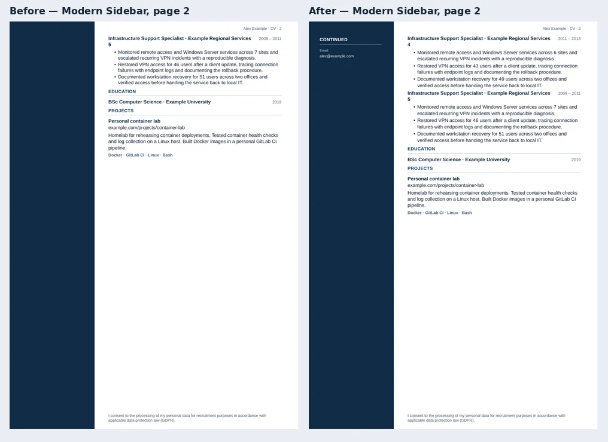

# Modern Sidebar: evidence and pagination

Modern Sidebar remains the designed two-column option. ATS Classic remains
separate and retains its existing soft one-page content selection.

## What changed

At `3fecc25`, the render engine automatically tightened spacing on every
multi-page Modern Sidebar CV. The second page kept the full-height navy
background but usually had no sidebar text. The only redistribution was for
very short tails (under 20% of the available height), so a second page with a
single job and a project could still be visually sparse.

- Standard Modern Sidebar exports retain the whole Truth Lock–validated
  resume. An optional spacing-only render can prevent a short spill, but it
  is accepted only if page count improves and the text is complete. Body type
  remains 10 pt. Explicit legacy hard fitting is separate.
- Normal-sized roles stay together; over-height entries can still flow across
  pages. For a sparse final page, try up to three real section/entry breaks and
  accept only a measurable improvement without adding pages or making the
  preceding page sparse. A structural break does not change the text.
- The page-one photo/initials, contact panel, typography, skills, languages,
  colors and links remain unchanged. Page two retains the navy panel, adding
  a discreet “Continued” label and clickable primary contact. It does not
  repeat the portrait, skills or other profile material. If a large sidebar
  itself flows across pages, its original content replaces the running contact
  on those pages.
- PDF remains tagged, vector and searchable. Offline HTML uses the same
  paginated source and the same links; it does not rasterize candidate text.
  Chromium print retains the A4 page boundaries. DOCX has its existing
  single-column editable layout, optional Modern photo, full content and
  clickable links, but **not** the navy sidebar, PDF-specific page breaks
  or continuation furniture. Ordinary job blocks stay together in the
  Modern DOCX; unusually long blocks can flow. Its page count depends on
  the word processor.



## Measured before and after

Same candidate facts, offers and deterministic generation; baseline **`3fecc25`**
(the previous PR #126 head, not the earlier `main` benchmark).
Main-column occupancy is the vertical span of actual text boxes divided by
available page height, not the area covered by ink.

| Fictional profile | PDF pages (both themes) | Employment bullets retained (both themes) | Modern main-column span, before → after |
|---|---:|---:|---|
| Short, with photo/links | 1 → 1 | 6/6 | 53% → 53% |
| Medium, seven roles | 2 → 2 | 21/21 | 87% / 33% → 77% / 48% |
| Long, ten roles | 2 → 2 | 30/30 | 87% / 75% → 77% / 92% |

PDF raster comparison: the short Modern example and all three ATS Classic
examples are pixel-identical to the baseline on this host. Geometry and
links are checked in rendered pages. The medium DOCX was also rendered and
visually spot-checked in LibreOffice.

The five offer scenarios were separately exported in both themes, before
and after. Their per-theme reports were identical across revisions:

| Metric, across five exports | ATS Classic | Modern Sidebar |
|---|---:|---:|
| Target employment facts | 10/10 | 10/10 |
| Selected employment bullets | 21 | 21 (same bullets) |
| Selected personal projects | 2 | 2 (same projects) |
| One-page PDFs | 5/5 | 5/5 |
| Extractable checked fragments per format (PDF, DOCX, HTML) | 95/95 | 95/95 |
| Factual/provenance audit flags | 0 | 0 |
| Main-column span | 50.0–65.5% | 28.7–43.8% |

The last row is not a quality target: Modern Sidebar puts skills, contact
details and languages in the separate navy column. A short profile is not
padded merely to fill the page.

## Reproduce

Run from this branch using the pinned development environment and Chromium:

```bash
PYTHONPATH=. python scripts/compare_resume_quality.py --template both --exports \
  --output /tmp/cvtailor-quality-two-themes
PYTHONPATH=. python scripts/compare_modern_pagination.py \
  --output /tmp/cvtailor-modern-pagination
pytest -q tests/test_modern_evidence_pagination.py tests/test_evidence_based_resume_quality.py \
  tests/test_sidebar_pagination.py tests/test_html_resume_themes.py \
  tests/test_rendered_source_fragments.py tests/test_preferred_one_page.py
```

To reproduce the `before` run, add a detached worktree at `3fecc25`, change
into it and invoke the new scripts from this worktree with
`PYTHONPATH="$PWD:$FEATURE_WORKTREE"` (baseline first). Raw artifacts belong
outside git. The embedded image contains only fictional data.

There is no forced two-page maximum. Extremely long entries, unusually long
sidebar text and font differences across software can still change page
breaks. Balance is best-effort at valid content boundaries; content retention
and layout checks take precedence over a mathematically even split.
