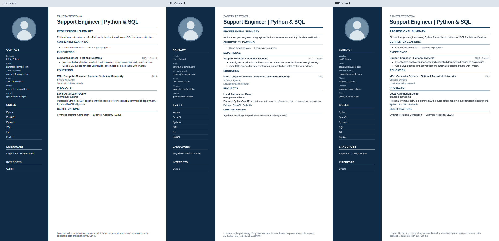
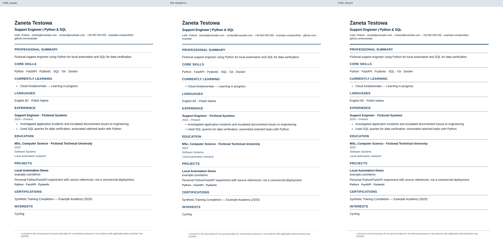

# Offline HTML resume export

The saved-CV preview offers **Download HTML**, **Download HTML + CSS ZIP** and **Preview offline HTML** alongside the unchanged PDF/DOCX exports. These are read-only views of the current saved CV, including saved edits, section ordering/exclusions and learning labels. They do not call AI, update the master profile, change evidence references, create history versions or replace existing PDF/DOCX files. Contact/language values come from the active account profile. Truth Lock's existing saved-record validation and summary review remain the boundary. Internal evidence IDs are retained in storage, not printed.

## Technical Specifications

- **Template Mapping**:
  - `modern_sidebar`: Uses the original 61mm sidebar / two-column layout.
  - `ats_classic`: Uses the original ATS layout.
- **Assets**:
  - Shared components: `templates/resume.html` and `static/resume.css`.
  - Browser overrides: `static/resume-browser.css`.
- **Formats**:
  - Single HTML: Self-contained UTF-8 with inline CSS.
  - ZIP: Includes `index.html` and `style.css`.
  - No JavaScript dependencies. The selected Modern Sidebar photo is embedded as a data URI; ATS retains its existing photo-free design. Email values remain text with `mailto:` links.
- **Access & Retrieval**:
  - Preview: Accessible at `/html-preview/{slug}` as `text/html`.
  - Cloudflare: Uses `email_off` markers; no external CF scripts or remote fonts are included.
- **Properties**:
  - Attachment header: `application/octet-stream`.
  - Cache Control: `Cache-Control: private, no-store, no-transform`, combined with binary attachment transport, to avoid HTML/email/script rewriting by intermediaries. No production CDN configuration is changed.
- **Layout & Rendering**:
  - A4 canvas: Maintained at 100% on mobile; it does **not** collapse to single-column (horizontal scroll is possible).
  - Rendering: Pixel-perfect results are not guaranteed as browser/WeasyPrint interpretation of very long CVs may vary.
  - Page boundaries and column geometry come from the same WeasyPrint pagination used by PDF. HTML retains semantic sections, paragraphs, lists and links, not rasterized text or positioned glyphs.
  - Text can be edited in VS Code. For substantial edits, re-export the saved CV to recalculate page boundaries; manually lengthening a pre-paginated page does not automatically move its content to the following page.
- **Operations & Security**:
  - Processing: The additive `html` operation runs in the documents worker, with the same authentication, network isolation, resource and deadline limits as PDF processing.
  - Security: Maintains all existing safety boundaries.
  - Implementation: Retains `saved text`, `edits`, `source IDs`, `Truth Lock`, and `profile/history` (read-only).
  - Deployment: A future rollout must use matching API and documents-worker versions supporting `html`. This change does not deploy or restart anything.

Regression coverage: `pytest -q tests/test_html_resume.py tests/test_html_resume_themes.py tests/test_html_resume_access.py` (themes, escaping, exact statements, non-mutation, ZIP, access/review checks, photo/email links, PDF/DOCX and pagination).

Generate fictional examples and browser/PDF/A4-print comparisons without starting a server or reading a private profile:

```bash
python -m scripts.compare_resume_themes --output /tmp/opencode/resume-theme-previews
```

## Visual comparisons (fictional data)

Each image shows browser HTML, the existing WeasyPrint PDF, and browser A4 print.
The portrait is a generated abstract test avatar, not a candidate photograph.




