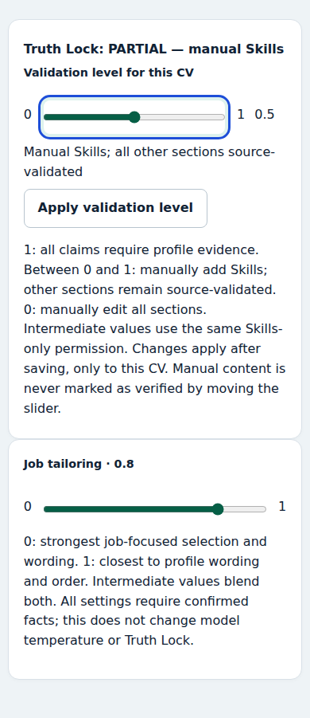

# Safe manual CV edits

## Verified cause

The old `save_resume_edit` computed `changed` by comparing every summary, experience bullet and project description/technology list with the output of a new full `FactValidator.validate` pass. It also checked **every** submitted skill against current bank eligibility, including retained saved wording. Neither check distinguished edited fields from saved fields.

Read-only verification found three real saved documents containing `Playwright browser automation`. After removing only that skill, the newest document triggered the project-comparison branch, specifically **`project_1_description`**; summary, experience and retained-skill conditions were false. Two other saved documents triggered both project and summary comparisons. These were changes proposed by global revalidation, not submitted edits. The new scoped validation returns zero blocking issues for the same removal. No production document, profile or bank was written by this reproduction.

A second full validation in `_regenerate_artifacts` could then rewrite unchanged content after admission. Stale `selected_skill_ids`, inferred using a positional zip with displayed skills, could resurrect a removed choice. Rebuilding a typed editor copy also discarded the private saved summary attestation.

## Optional per-document manual mode

The behavior below describes the default, enabled Truth Lock. An authenticated owner can explicitly turn it off for one saved CV using the control on the preview/editor. `truth_lock_enabled` and the optional `truth_lock_level` are stored in that document metadata; older documents and new generation default to enabled. POST `/preview/{slug}/truth-lock` requires CSRF and accepts a numeric `level` from 0 to 1 (legacy `enabled=on/off` requests remain supported). Forging an edit form flag cannot disable validation.

With the switch off, `manual_resume.manual_edit` retains typed user input and labels changed citations as manual rather than verified. It clears source IDs/attestation for changed summaries and bank IDs for changed skills. Profile/Skills Bank data and other CVs remain unaffected. Summary confirmation, contact/link/quality checks, layout handling, staged rendering and backups still apply. Layout changes and reset respect the selected mode. Re-enabling first audits the saved content; unsupported content returns 409 and remains in manual mode. Restore/regenerate source-backed content to enable it again. The exported document contains the chosen skill wording, while the application visibly displays the manual status.

A synthetic mobile preview of the control (no personal data):

Earlier binary-switch verification: **42 passed** across `test_manual_truth_lock.py`, `test_safe_resume_edits.py`, and `test_summary_confirmation.py`, using current pinned dependencies in a temporary virtual environment. Browser checks covered keyboard focus, editable headline, a 390px viewport without horizontal overflow and visibility at 200% zoom.

## Behavior

`FactValidator.validate_manual_edit` uses the existing source validator to check new/modified claims and audit saved claims. It returns the exact edited document plus separate field issues and source-review warnings, rather than substituting the globally regenerated document.

- Removed skills, interests, bullets and optional project information are omissions, not new claims. They stay removed.
- Retained skills do not need reapproval to permit an unrelated deletion. Unverifiable or overstated saved wording is flagged separately, without adding approved bank IDs to it.
- New skill wording must be eligible and approved at the displayed level. Unknown technology and proficiency inflation are rejected with the field, reason and correction.
- Changed summary/headline/project text must survive current source validation. Modified employment bullets must also be supported by their own employment citations, with the correct owner; auto-filled unrelated facts cannot approve them. Changed project claims require project-owned references.
- Skill IDs are resolved from approved displayed wording, never list positions. Unchanged references and private summary attestations are preserved; edited evidence references can be normalized to stable IDs.
- Legacy/source-review warnings are shown in the editor and saved in metadata for preview. The preview uses a neutral source-validation-notes label because these claims were audited, not silently removed or approved.

Normal generation/reset validation remains available. The manual export path accepts only the server's scoped validation result, prevents layout fitting from changing its content, and retains staged PDF/DOCX rendering and atomic commit/rollback. Profile and Skills Bank are not modified by document deletions.

## Earlier full-suite verification of the binary manual switch

Using the current pinned dependencies in an isolated temporary environment: **805 passed, 1 failed, 1 warning** out of 806 tests. The remaining failure is `test_ats_preserves_long_text_and_reading_order`, which exceeds the existing 60-second document-processing deadline. This long-PDF timeout was also reproduced on pristine HEAD during the earlier RAG audit (see [RAG verification](archive/rag-verification.md)); the manual-switch work does not change that renderer or timeout. The warning is the existing Starlette/httpx deprecation. Ruff, pinned-environment validation, pip check, README synchronization and whitespace checks passed. No deployment was performed.

## Historical validation of the original editor repair

Full suite: **485 passed, 2 skipped**. After the final parser/citation adjustments, all **16 editor regressions** passed. Ruff and whitespace checks passed.

The regressions use authenticated, CSRF-protected edit requests, real PDF/DOCX export and reopened saved documents. They cover single/multiple/all-skill removal, unchanged summary/projects/experience, legacy/inconsistent IDs, unknown technology, inflated levels, changed-summary and employment rejection, valid source-backed modification, optional omissions, summary-attestation preservation, comma/whitespace-containing labels, project reference corruption, export failure before commit and metadata-save failure after replacing artifacts. Both rollback cases preserve prior JSON/metadata/PDF/DOCX bytes. Deletion tests verify unchanged private profile/bank bytes and that the original generated CV remains intact.

## Validation and tailoring sliders

The per-document validation range has explicit permission boundaries: 0 is manual editing, 0 < level < 1 permits manual Skills only, and 1 is full source validation. It defaults to 1, including for older records without level metadata. Moving from manual mode to a stronger mode audits the sections that will become protected. Unsupported saved claims block the transition; moving the slider never grants verified provenance. Manual Skills clear skill source IDs and remain visible in application status. The control uses a native range input with keyboard support, an explicit apply button, CSRF and server-side 0–1 validation. It works without JavaScript.

Job tailoring is separate and is chosen before analysis; it controls ranking and wording, not permission to fabricate. Its intermediate values continuously blend BM25 relevance with profile order and set the provider rewriting budget. Generating from the report or an existing CV reuses its saved analysis, revalidates it locally against the current profile and creates a new draft using canonical profile facts and leaves existing exports intact. Neither control changes model temperature.

## Verification of the sliders and saved-analysis regeneration

The current targeted regression runs cover **91 passing tests** across `test_manual_truth_lock.py`, `test_fact_retrieval.py`, `test_retailor.py`, `test_safe_resume_edits.py`, `test_summary_confirmation.py`, `test_tailoring_priorities.py`, `test_task_manager.py`, and `test_provider_fallback.py`. This includes real PDF/DOCX generation, rollback, intermediate-mode employment rejection, unsupported-skill rejection in AI generation at all tailoring settings, locally revalidating a saved analysis before generation, provider fallback without a second analysis request, level persistence, CSRF, and preserving existing CVs. Ollama/Gemini calls are stubbed: each submitted slider setting makes one CV-generation call and zero analysis calls in the successful reuse path. No paid model or production service was used; no latency or token savings were measured.

Synthetic Chromium checks passed for both sliders, keyboard controls, live intermediate values, 390px reflow and visibility at 200% zoom. A second browser check verified reviewing current draft text and posting the report's slider to the saved-analysis regeneration route. Ruff, environment validation, README synchronization and whitespace checks passed. The earlier full-suite result above predates the sliders; a new full-suite run is not claimed.
